

  

<h1 align="center">Filament-Lager</h1>

  Übersichtliche Lagerverwaltung für 3D-Druck-Filament als App für Home Assistant. 
  Arbeitet direkt mit <a href="https://github.com/maziggy/bambuddy">Bambuddy</a> zusammen: ein Bestand, keine doppelte Pflege.

  

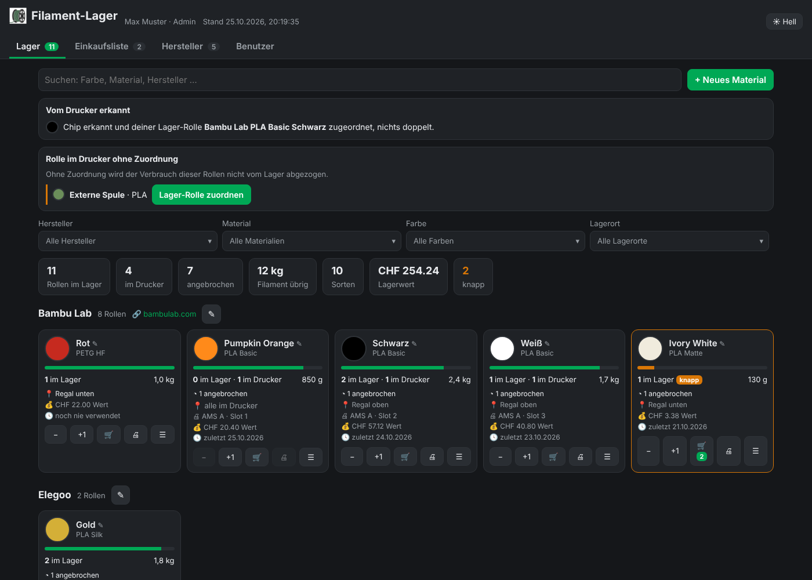

## Was die App kann

Bambuddy zählt den Filamentverbrauch deiner Bambu-Lab-Drucker automatisch mit, die Lagerverwaltung dort ist aber eher technisch. Filament-Lager legt eine einfache Oberfläche darüber und speichert alles direkt in Bambuddy.

- **Übersicht auf einen Blick**: jede Sorte als Farbkachel, gruppiert nach Hersteller (mit eigenem Logo und Link zur Webseite). Du siehst Rollen im Lager und im Drucker, angebrochene Rollen, Restgewicht, Lagerplatz und wann das Material zuletzt verwendet wurde. Was knapp wird, ist orange markiert, was leer ist, rot.
- **Schnell erfassen**: „+1 Rolle“ bei jeder Sorte oder „Neues Material“ mit Hersteller, Material, Typ, Farbe (auch als Hex-Code), Gewicht, Anzahl und Lagerplatz.
- **Keine Doppelten**: Schreibweisen werden vereinheitlicht („bambu lab“ wird „Bambu Lab“), und gibt es eine Sorte schon, schlägt die App vor, die Rollen dort dazuzubuchen.
- **Einkaufsliste**: Warenkorb-Knopf an jeder Sorte, Status „zu kaufen“, „bestellt“, „eingetroffen“. Beim Eintreffen werden die Rollen direkt ins Lager gebucht. Neben jedem Eintrag steht der aktuelle Lagerbestand.
- **Rollen im Drucker**: „🖨“ legt eine Rolle in einen AMS-Platz oder auf die externe Spule. So zieht Bambuddy auch bei Rollen ohne Chip den Verbrauch jedes Drucks ab. Steckt eine Rolle ohne Zuordnung im Drucker, zeigt die App oben einen Hinweis mit „Lager-Rolle zuordnen“. Auf jeder Kachel steht, in welchem Platz die Rollen stecken.
- **Rollen einzeln**: „☰“ zeigt jede Rolle mit Restgewicht, Platz, Wert und den letzten Drucken samt Verbrauch. Lagerplatz und Restgewicht lassen sich dort pro Rolle ändern. Das Restgewicht lässt sich direkt eintragen oder aus dem Gewicht auf der Waage berechnen (das Leergewicht der Spule wird abgezogen).
- **Preise**: Preis pro kg je Sorte, daraus Wert pro Rolle und Lagerwert.
- **RFID-Abgleich**: Steckst du eine Bambu-Rolle mit Chip ins AMS, die du vorher schon im Lager erfasst hast, ordnet die App den Chip dieser Lager-Rolle zu. Nichts wird doppelt gezählt.
- **Bearbeiten und Ausbuchen**: fehlende Angaben nachtragen, Farben korrigieren, eine zu viel erfasste Rolle wieder ausbuchen (wird in Bambuddy archiviert, nicht gelöscht).
- **Bestätigung**: jedes Ein- und Ausbuchen von Hand fragt vorher nach.
- **Filter**: nach Hersteller, Material, Farbfamilie und Lagerort, jeweils mit Mehrfachauswahl.
- **Benutzerrechte**: pro Home-Assistant-Benutzer einstellbar, wer nur schauen, erfassen oder auch bearbeiten darf.
- **Hell oder dunkel**: standardmäßig dunkel, oben rechts umschaltbar. Die Wahl gilt pro Benutzer auf allen Geräten.
- **Aktuell**: die Seite aktualisiert sich alle 15 Sekunden von selbst und funktioniert auch auf dem Handy und über Nabu Casa.

## Bilder

| Einkaufsliste | Hersteller |
|---|---|
| 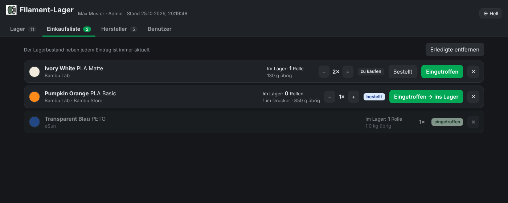 | 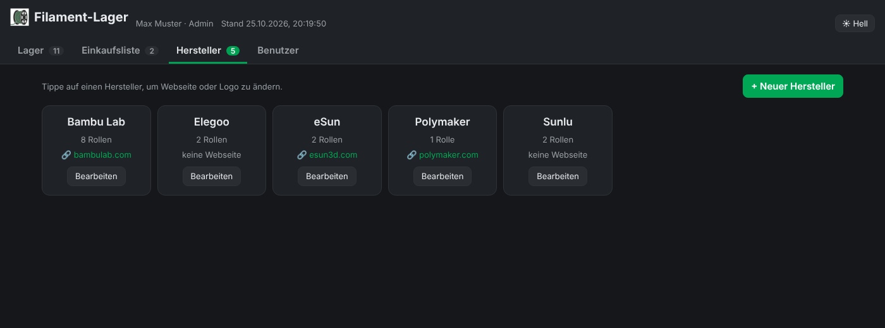 |

| Hersteller bearbeiten (Webseite, Logo) | |
|---|---|
| 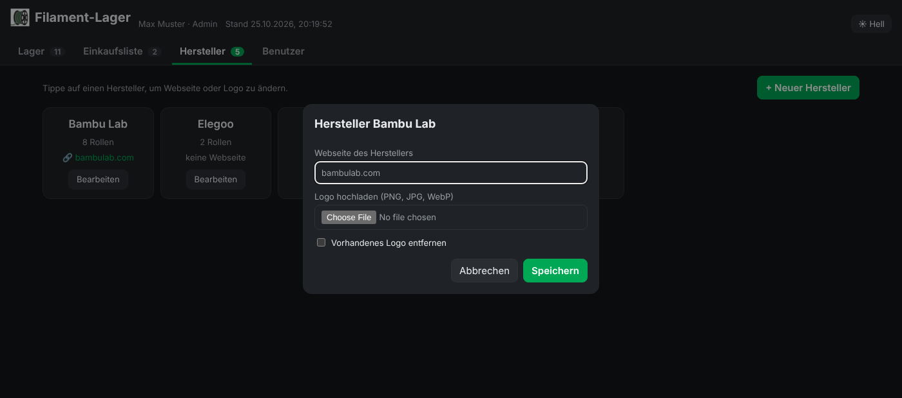 | |

| Neues Material mit Hinweis auf vorhandene Sorte | Sorte bearbeiten |
|---|---|
| 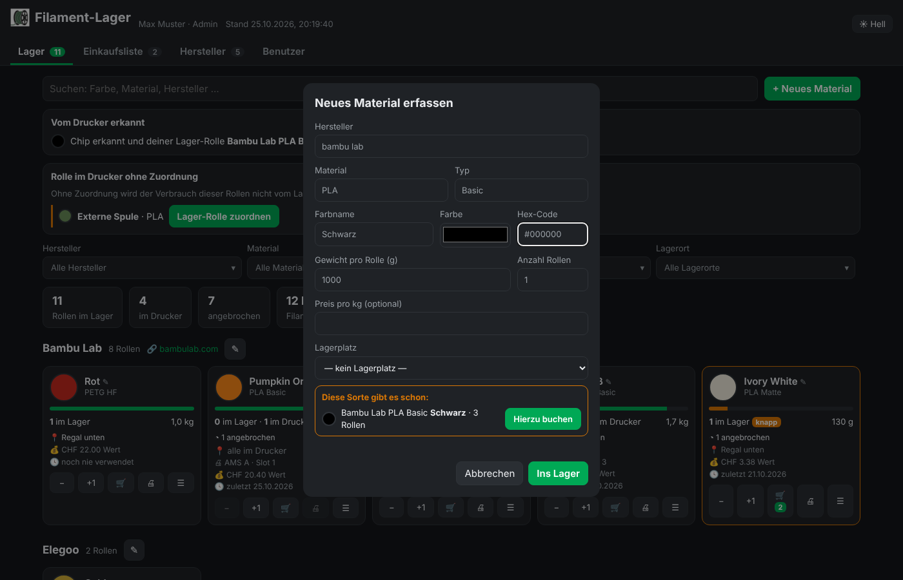 | 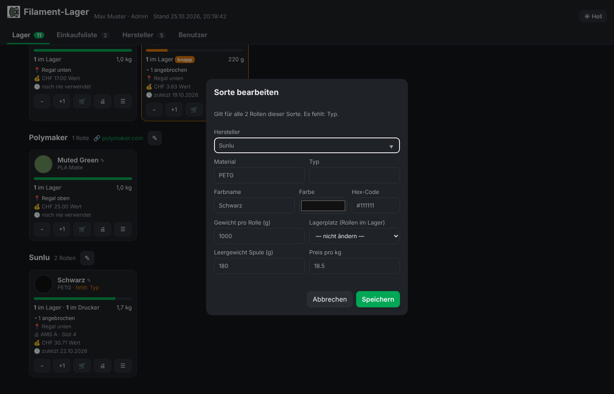 |

| Bestätigung vor dem Einbuchen | Filter mit Mehrfachauswahl |
|---|---|
| 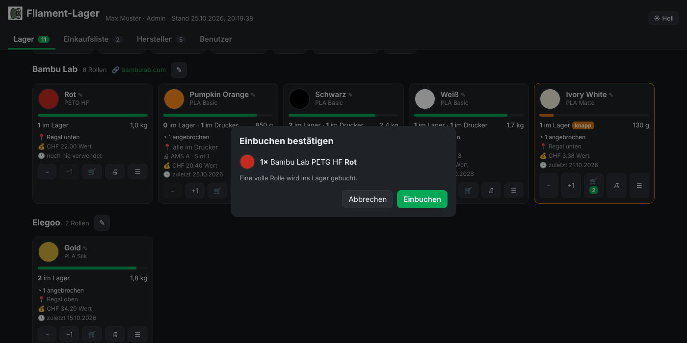 | 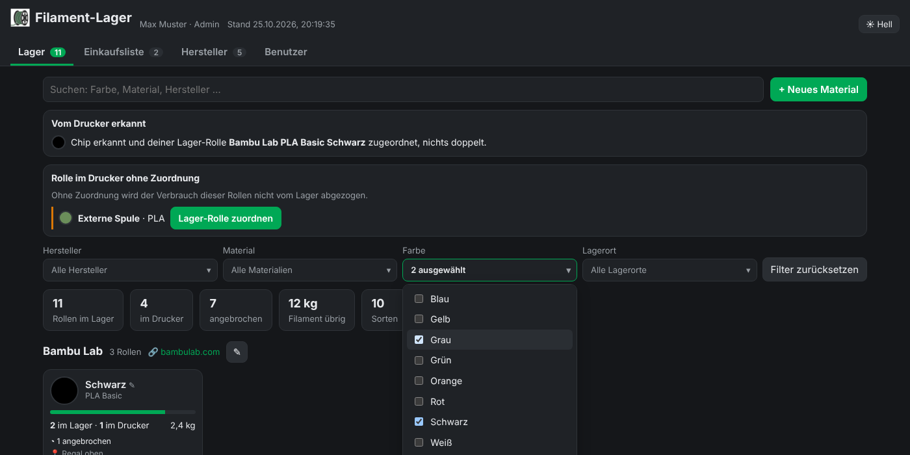 |

| Rolle in den Drucker einlegen | Rollen einzeln mit Restgewicht und Verbrauch |
|---|---|
| 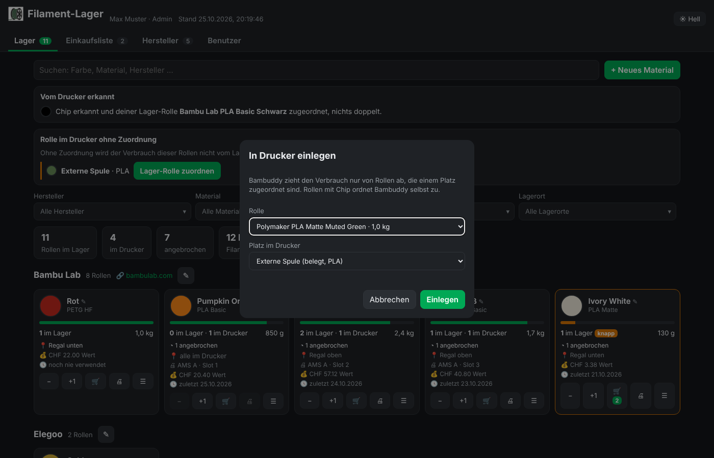 | 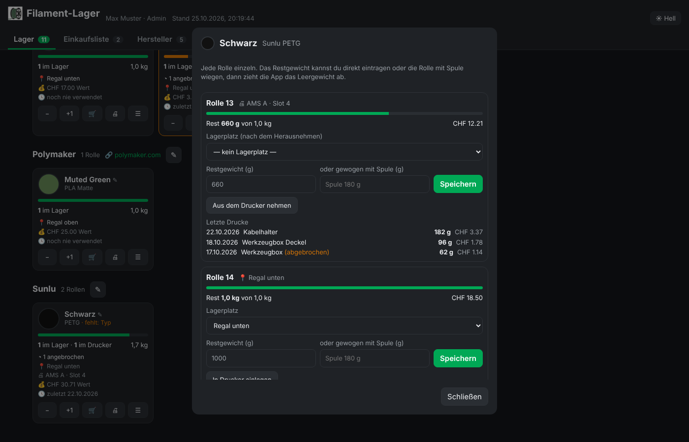 |

| Benutzer | Auf dem Handy |
|---|---|
| 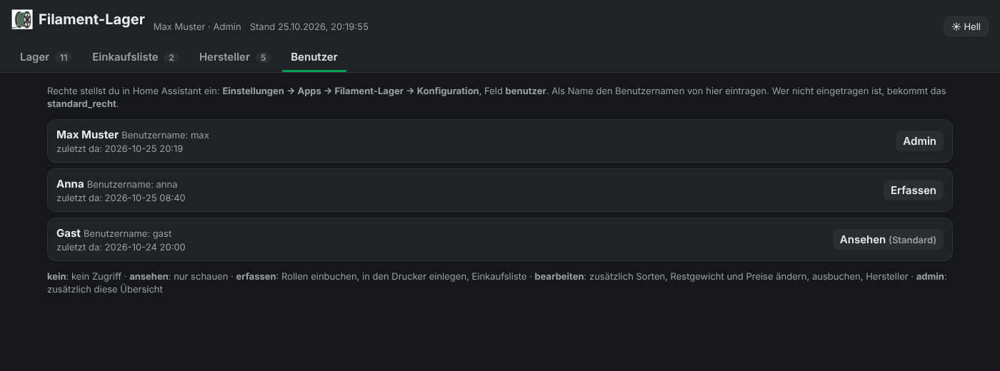 | 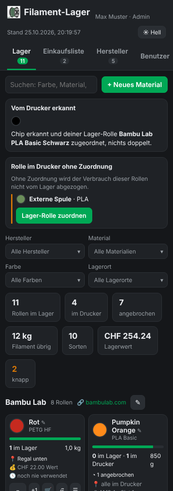 |

## Voraussetzungen

- Home Assistant OS oder Supervised (also mit App-Store, früher „Add-ons“)
- [Bambuddy](https://github.com/maziggy/bambuddy), zum Beispiel als Home-Assistant-App, mit eingeschalteter Anmeldung
- Ein API-Schlüssel aus Bambuddy mit den Rechten **Inventar verwalten** und **Status lesen** (ist standardmäßig an)

## Installation

1. **Repository hinzufügen**: Klick oben auf den blauen Knopf „Repository zu Home Assistant hinzufügen“.
   Oder von Hand: Einstellungen → Apps → App-Store → oben rechts ⋮ → **Repositories** → `https://github.com/H0walD/filament-lager` eintragen → Hinzufügen.
2. **App installieren**: Im App-Store nach unten scrollen bis „Filament-Lager“, öffnen und **Installieren**. Die App wird dabei auf deinem Gerät gebaut, das dauert einen Moment.
3. **API-Schlüssel anlegen**: In Bambuddy unter Einstellungen → API-Schlüssel einen neuen Schlüssel erstellen, das Recht „Inventar verwalten“ einschalten und den Schlüssel kopieren. Bambuddy zeigt ihn nur dieses eine Mal an.
4. **Konfigurieren**: In der App den Reiter **Konfiguration** öffnen:
   - **Bambuddy-Adresse**: wo Bambuddy läuft, z. B. `http://192.168.1.50:8000`
   - **API-Schlüssel**: den kopierten Schlüssel einfügen
   - **Benutzer und Rechte**: dich selbst mit deinem Home-Assistant-Benutzernamen als `admin` eintragen (siehe unten)
   - Speichern
5. **Starten**: Im Reiter Info auf **Starten** und „In der Seitenleiste anzeigen“ einschalten. Fertig, „Filament-Lager“ steht jetzt in der Seitenleiste.

## Benutzer und Rechte

Die Rechte stellst du unter Einstellungen → Apps → Filament-Lager → **Konfiguration** ein.

| Recht | Darf |
|---|---|
| `kein` | nichts, sieht nur „Kein Zugriff“ |
| `ansehen` | Lager, Einkaufsliste und Hersteller ansehen |
| `erfassen` | zusätzlich Rollen einbuchen und die Einkaufsliste pflegen |
| `bearbeiten` | zusätzlich Sorten ändern, Rollen ausbuchen, Hersteller und Webseiten pflegen |
| `admin` | zusätzlich Logos hochladen und den Reiter „Benutzer“ sehen |

- **Benutzer und Rechte**: ein Eintrag pro Person, mit dem Home-Assistant-**Benutzernamen** (nicht dem Anzeigenamen) und dem Recht.
- **Standard-Recht**: gilt für alle, die nicht eingetragen sind. Voreingestellt ist `ansehen`.
- Den Benutzernamen findest du in Home Assistant unter Einstellungen → Personen → Benutzer, oder in der App im Reiter „Benutzer“, sobald die Person die App einmal geöffnet hat.
- Änderungen gelten sofort, ohne Neustart. Die App prüft die Rechte auch auf dem Server, nicht nur in der Anzeige.

## Hersteller, Webseiten und Logos

Im Reiter **Hersteller** siehst du alle Hersteller mit Anzahl Rollen und Webseite.

- **Webseite**: mit dem Recht `bearbeiten` trägst du sie unter „Bearbeiten“ ein. Sie erscheint dann als Link im Lager und auf der Hersteller-Seite, so findest du den Shop schnell.
- **Logo**: Admins laden es dort als PNG, JPG, WebP oder GIF hoch. Ohne Logo zeigt die App einfach den Namen. Logos werden nie automatisch aus dem Internet geholt.

## Sichtbarkeit in der Seitenleiste

Home Assistant kennt für App-Einträge in der Seitenleiste nur „alle Benutzer“ oder „nur Admins“. Filament-Lager ist für alle Benutzer freigegeben; wer das Recht `kein` hat, sieht beim Öffnen nur „Kein Zugriff“. Jeder Benutzer kann den Eintrag zusätzlich in seinem Profil unter **Seitenleiste bearbeiten** ausblenden.

## RFID-Rollen richtig erfassen

Damit der Bestand stimmt, so vorgehen:

1. Neue Rolle zuerst in Filament-Lager erfassen (oder über die Einkaufsliste „Eingetroffen“).
2. Rolle ins AMS stecken. Bambuddy legt über den Chip eine Rolle an.
3. Filament-Lager erkennt sie innerhalb einer Minute an Hersteller, Material, Typ und Farbe, hängt den Chip an deine Lager-Rolle und archiviert die doppelte.

In Bambuddy muss dafür „Unbekannte RFID-Spulen automatisch hinzufügen“ eingeschaltet sein. Passt ein Chip zu mehreren Sorten, fragt die App oben unter „Vom Drucker erkannt“ nach.

## Rollen ohne Chip

Bambuddy zieht den Verbrauch nach jedem Druck von der Rolle ab, die dem benutzten AMS-Platz zugeordnet ist, auch wenn der Druck direkt aus Bambu Studio gestartet wurde. Rollen mit Chip ordnet Bambuddy selbst zu, Rollen ohne Chip musst du zuordnen:

1. Rolle ins AMS stecken.
2. In Filament-Lager bei der Sorte auf **🖨** tippen (oder im Hinweis „Rolle im Drucker ohne Zuordnung“ auf **Lager-Rolle zuordnen**), Rolle und Platz wählen, **Einlegen**.
3. Kommt die Rolle wieder raus: **☰** → **Aus dem Drucker nehmen**. Das Restgewicht bleibt erhalten.

Hast du eine angebrochene Rolle gewogen, trägst du das Gewicht unter **☰** ein. Danach gleicht Bambuddy diese Rolle nicht mehr mit der Prozentanzeige des AMS ab, zieht den Verbrauch aus Drucken aber weiter ab.

## Häufige Fragen

**„Noch kein API-Schlüssel eingetragen“ oder „Bambuddy lehnt den Schlüssel ab“**
Schlüssel in der Konfiguration prüfen. Er muss vollständig sein (beginnt mit `bb_`) und das Recht „Inventar verwalten“ haben.

**„Bambuddy ist gerade nicht erreichbar“**
Läuft Bambuddy? Stimmt die Bambuddy-Adresse in der Konfiguration?

**Andere Benutzer sehen nur „Kein Zugriff“**
Sie stehen nicht unter „Benutzer und Rechte“ und das Standard-Recht ist `kein`. Eintragen oder Standard-Recht ändern.

**Ändert die App etwas an meinen Druckern?**
Nur wenn du eine Rolle einlegst und beim RFID-Abgleich: Bambuddy stellt dann Material und Farbe des AMS-Platzes passend zur Rolle ein. Sonst liest die App von den Druckern nur, welche Plätze belegt sind.

## Datenschutz

Alle Daten bleiben bei dir: Rollen, Einkaufsliste und Lagerplätze liegen in Bambuddy, Logos und Einstellungen in der App auf deinem Home-Assistant-Gerät. Die App selbst baut keine Verbindung ins Internet auf.

## Lizenz

[MIT](LICENSE)
